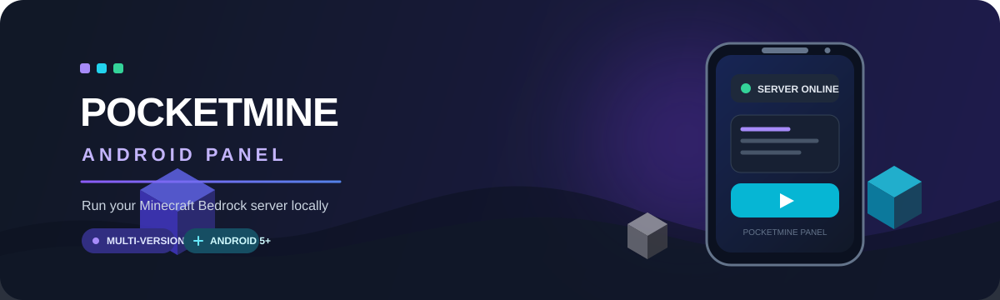

  

  

  <strong>An Android panel for running a Minecraft Bedrock server locally with PocketMine-MP.</strong>
   
  Run your server directly on your Android device, without a separate server machine.

  
  
  
  

---

## ✨ About

**Android PacketMinePm Panel** lets you run **PocketMine-MP** locally on an Android device and host a **Minecraft Bedrock** server without a separate computer.

## 🚀 Features

- 📱 Run a PocketMine-MP server on your Android device
- 🧩 Multi-version support
- 🤖 Compatible with Android 5 and newer
- 🎮 Host a Minecraft Bedrock server

## 📥 Download

Visit the [Releases page](https://github.com/EXBYPIXEL/Android-PacketMinePm-Panel/releases) for available versions and APKs. If no release is available yet, check back later.

## 🛠️ Getting Started

1. Download a published app version from **Releases** and install it on your Android device.
2. Select the version you want in the panel.
3. Start the server. Check your device's network settings and connection address so other players can join.

> Exact steps and options may vary between app versions.

## 🤝 Contributions and Issues

Have a suggestion or found a problem? Open an [issue](https://github.com/EXBYPIXEL/Android-PacketMinePm-Panel/issues). When reporting a bug, include your Android version, app version, and steps to reproduce it.

## ⭐ Support the Project

If you find this project useful, consider giving it a **Star** to help others discover it.

  Made for the Minecraft Bedrock and PocketMine-MP community 💜

